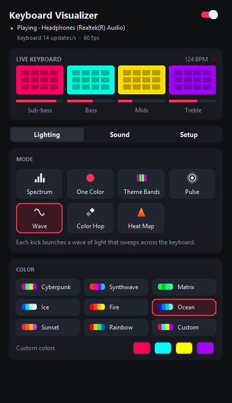
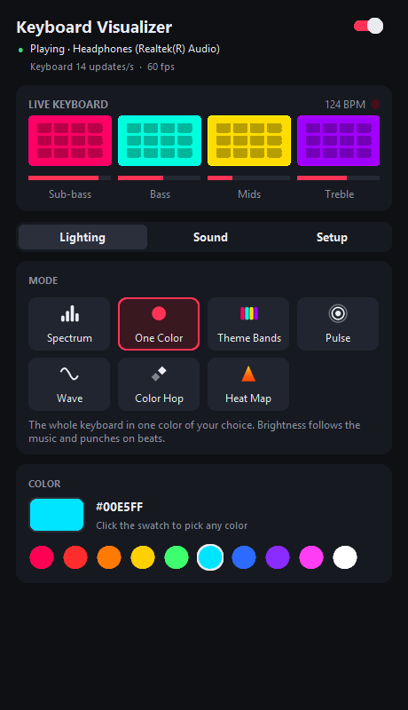
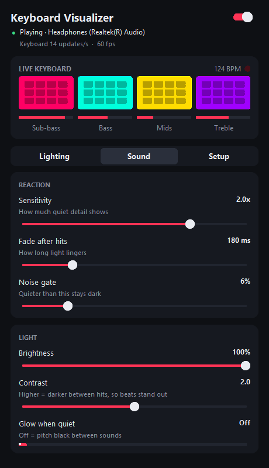

# Predator Keyboard Visualizer

A real-time music visualizer for the 4-zone RGB keyboard on the **Acer Predator Helios Neo 16 (PHN16-71)**.
It listens to whatever is playing on the laptop and turns it into light: bass on the left, treble on the numpad,
with beat detection driving the punchier modes. It runs quietly in the Windows tray with a settings window
for modes, colors and feel.

<p align="center">
  
  
  
</p>

## Highlights

- **Low-latency audio pipeline**: WASAPI loopback capture in 10 ms callback blocks into a ring buffer;
  beats are flagged 5-15 ms after a kick lands.
- **Music analysis built for a 4-zone keyboard**: FFT into four bands, measured in dB against each band's
  own recent hits, so quiet and loud songs both use the full brightness range while held notes don't max out.
- **Beat detection** from spectral flux in the kick range with an adaptive threshold, plus a live BPM estimate.
- **7 lighting modes**: Spectrum, One Color, Theme Bands, Pulse, Wave, Color Hop and Heat Map, with 9 color themes
  and custom colors.
- **Hardware-aware output**: the keyboard can only show about 15 updates a second, so each update carries
  each zone's brightest moment since the last one, and nothing is sent when the lights are steady.
- **Tray app**: single instance, live keyboard preview, settings saved between runs, original lighting
  restored on exit, and a warning when the audio setup is known to cause pops.

## The interesting part: tracking down audio pops

Early versions caused audible pops while the keyboard was lighting up. Instead of guessing, I measured it:

1. **Freeze probe** ([`tools/ec_stall_probe.py`](tools/ec_stall_probe.py)): two processes pinned to different
   CPU cores spin on the high-resolution clock. A gap on *both* cores at the same instant is a system-wide
   freeze (a firmware SMI), which is exactly what starves an audio driver.
2. **Finding**: any keyboard write wakes Acer's lighting service, which then pushes to the keyboard on a fixed
   **~64 ms tick**, and **every tick freezes all cores for ~6 ms**. The write rate, the colors and the number of
   zones changed made no difference, so the cost is in waking the service, not in the data.
3. **Trying to bypass it** ([`tools/wmi_led_probe.py`](tools/wmi_led_probe.py)): Acer's firmware WMI interface accepts
   per-zone colors and stores them, but on this model the LEDs only update through Acer's own service, so there's no supported way around it.
4. **Root cause of the pops**: the freezes are harmless when audio plays straight to the Realtek output, but
   Elgato Wave Link's virtual mixer can't ride through them. Confirmed by ear in both directions.

Result: the app sends nothing when the lights are steady or dark (zero freezes), and warns when the Windows
output is Wave Link. Full write-up with the numbers: [docs/conclusions/keyboard_pops_investigation.md](docs/conclusions/keyboard_pops_investigation.md).

Other measurement-driven fixes along the way:
- **Missed fast hits**: sending whichever frame was newest dropped up to a third of snares and hi-hats in fast music.
  Peak-of-group sending catches all of them ([`tests/frame_pick_sim.py`](tests/frame_pick_sim.py)).
- **Lights never reaching full**: the analyzer was scaling each band against its single loudest recent moment.
  Switching to "typical hits over the last 3 s" took typical hits from 57-75% to 83-88% brightness
  ([`tests/peak_probe.py`](tests/peak_probe.py)).

## How it works

```
WASAPI loopback (10 ms blocks) ──► ring buffer
        │
        ▼  60 fps
Analyzer: Hann-windowed FFT ─► 4 bands in dB ─► hit normalization ─► attack/release envelope
          kick-range spectral flux ─► beats + BPM
        │
        ▼
Lighting mode ─► 4 zone colors ─► brightness / idle glow ─► LED contrast correction
        │
        ▼  ≤15 updates/s, peak-of-group, skip invisible changes
Keyboard writer ─► OpenRGB SDK (PredatorSense) ─► Acer lighting service ─► keyboard
```

| File | Role |
|---|---|
| [`audio_capture.py`](audio_capture.py) | Loopback capture, auto-follows the output that's actually playing, recovers from device changes |
| [`audio_output.py`](audio_output.py) | Reads the current Windows default output through Core Audio (COM via ctypes) |
| [`analyzer.py`](analyzer.py) | Band levels, hit normalization, beat detection, BPM |
| [`lighting.py`](lighting.py) | Lighting modes, themes, LED contrast correction |
| [`keyboard.py`](keyboard.py) | OpenRGB connection, pacing, peak-of-group, restoring the original lighting |
| [`engine.py`](engine.py) | 60 fps real-time loop on its own thread |
| [`settings.py`](settings.py) | Thread-safe settings with debounced saving |
| [`tray_app.py`](tray_app.py), [`ui_window.py`](ui_window.py) | Tray icon, single-instance handling, settings window |
| [`tools/`](tools) | Hardware investigation probes |
| [`tests/`](tests) | Synthetic-music tests, UI click checks, measurement scripts |

## Getting started

**Requirements**
- Windows 10/11 and Python 3.10+
- An Acer Predator laptop with a 4-zone keyboard and **PredatorSense** running with keyboard lighting on
  (it provides the OpenRGB server the app talks to). Built and tested on the PHN16-71.

```bash
git clone https://github.com/ignRean/predator-keyboard-visualizer.git
cd predator-keyboard-visualizer
pip install -r requirements.txt
```

**Run it**
- Double-click **`Predator Visualizer.pyw`** (no console window), or
- `python main.py` for the tray app and settings window
- `python main.py --hidden` to start in the tray only
- `python main.py --quit` to close a running copy (restores your lighting)
- `python main.py --headless` to run with saved settings and no UI

Right-click the tray icon to switch modes and themes, pause, or quit.

## Testing

```bash
python verify_all.py               # beat detection, band separation, modes - synthetic music, no hardware
python tests/ui_check.py           # every control clickable where it's drawn
python verify_all.py --hardware    # also opens audio capture and flashes the keyboard
```

## Known limitations

- Acer's lighting service briefly freezes the PC on every keyboard update while lights change. With audio
  going straight to Realtek this is inaudible; through Elgato Wave Link it pops.
- The keyboard can show about 15 changes a second, so very fast patterns (32nd-note hi-hats) blur together.
- Only tested on the PHN16-71; other 4-zone Predator models with PredatorSense's OpenRGB server will likely work.

## License

MIT - see [LICENSE](LICENSE).
